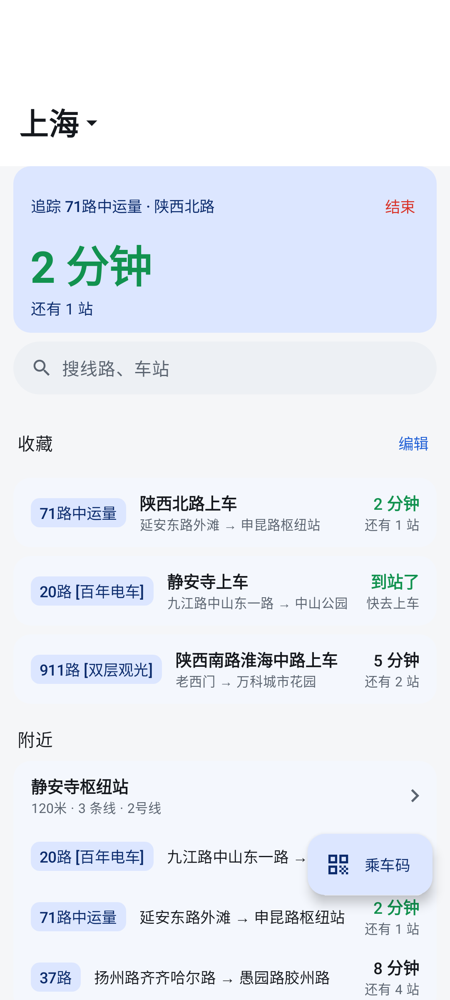
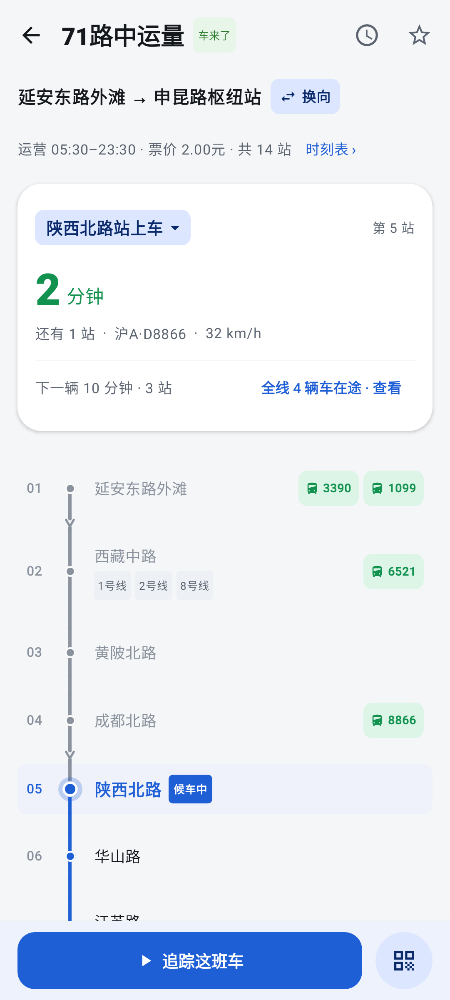
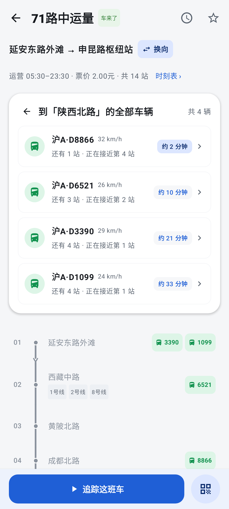
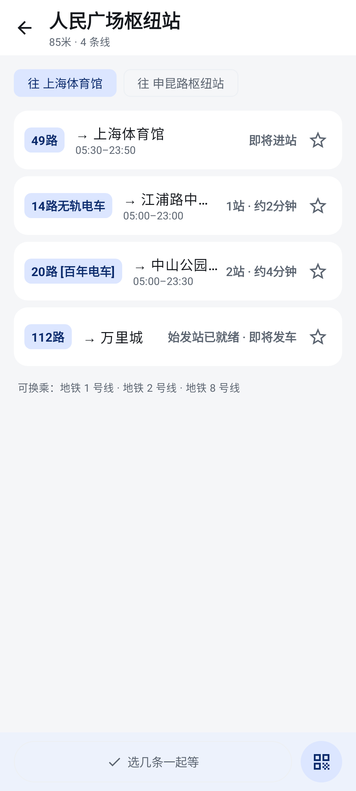
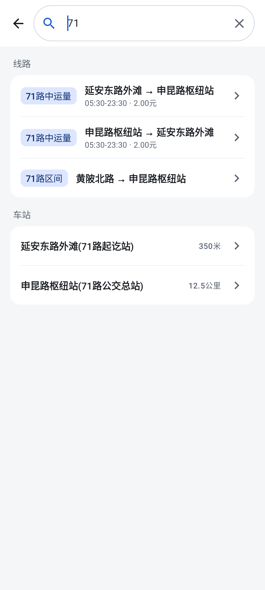
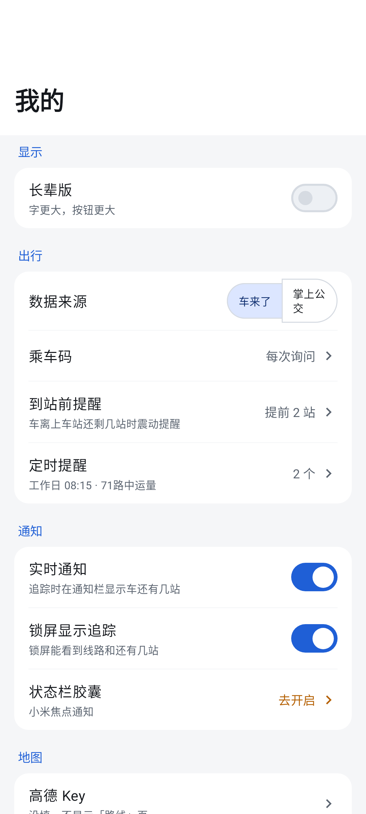
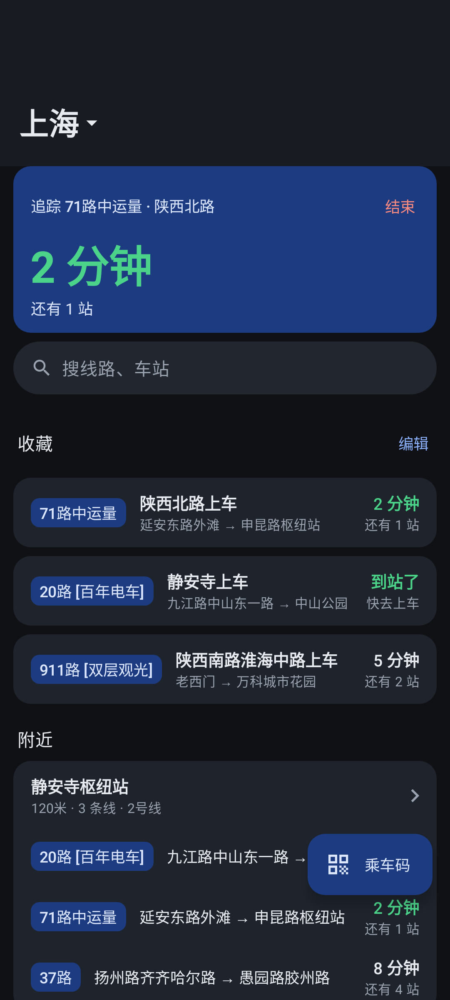
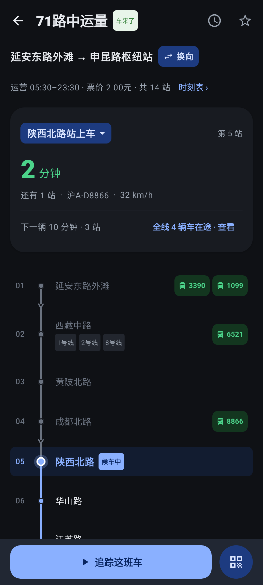

<div align="center">


# 追客 · Trackr

<p align="center">
  <strong>Android 实时公交到站追踪</strong>
</p>

<p align="center">
  <a href="https://github.com/5151561/Trackr-/releases">
    
  </a>
  <a href="https://developer.android.com">
    
  </a>
  <a href="https://kotlinlang.org">
    
  </a>
  <a href="https://www.jetbrains.com/compose-multiplatform/">
    
  </a>
  <a href="LICENSE">
    
  </a>
</p>

</div>

---

## 📸 界面预览

| 公交首页 | 线路详情 | 在途车辆 | 站点详情 |
| :---: | :---: | :---: | :---: |
| <br/>公交首页 | <br/>线路详情 | <br/>在途车辆 | <br/>站点详情 |
| <br/>搜索 | <br/>我的 | <br/>深色首页 | <br/>深色线路 |

> 全部 11 张截图（含「关于」页和深色版本）见 [截图物料库](screenshots/index.html)。截图由 Robolectric 在 JVM 上按 412 × 915 dp 渲染，不依赖真机。

---

## 📖 项目简介

追客（Trackr / BusOnRoad）是一款 Android 实时公交到站追踪应用。它把「下一班还有几分钟」放在第一屏，围绕公交、线路、站点和换乘路线组织信息，没有开屏广告，也没有信息流。

应用基于 **Material Design 3 Expressive** 设计，采用 **MAD 分层架构 + Kotlin Multiplatform**：业务页面、状态和大部分 UI 在 `commonMain`，Android 平台能力经接口注入。数据来自车来了与掌上公交两个实时数据源，按城市自动选择可用通道。

---

## ✨ 功能

### 公交首页

- **追踪卡片**：正在追踪的线路显示下一班倒计时、剩余站数和「结束」入口，切换页面不丢状态。
- **收藏**：按上车站展示每条收藏线路的到站时间；支持排序、分组和编辑。
- **附近站点**：按距离列出周边站点，直接展开多条线路的到站信息。
- **乘车码**：悬浮按钮一键打开，跟随底部页签收起 / 展开移动。
- **城市切换**：首页标题点开城市列表，切换城市后收藏按城市分开显示。

### 线路与站点

- **线路详情**：竖向时间轴走向条，标出每个站的站序、途经车辆和当前候车站；支持换向、时刻表、收藏和开始追踪。
- **一起等多条线路**：在站点详情里勾选任意条线路一起等，等车阶段只发一次站点请求；车到站后可以确认「上了哪辆」。
- **到站前提醒**：按时间创建定时提醒，到点自动开始追踪，快到站时发通知。
- **站点详情**：多物理站台切换、地铁换乘标签、途经线路综合到站看板。

### 路线规划

- 输入起点和终点，用高德公交算路给出换乘方案，按「最快 / 少换乘 / 少走路」标注。
- 地图上画出每段步行与公交折线；没有地图 Key 时只显示方案卡片，不影响算路。
- 方案可存成一条收藏路线，也可以直接开始追踪其中一程。

### 搜索与其他

- **搜索**：拼音、汉字模糊匹配，线路按方向一行显示「始发 → 终点」，区分主线和区间车。
- **通知与桌面**：常驻进度通知、到站提醒通知、Glance 桌面微件；小米设备额外适配焦点通知。
- **长辈版**：单列大字号界面，三档字号（1.0 / 1.5 / 2.0 倍），按钮不小于 64 dp。
- **深色模式**：跟随系统，地图同步切换夜间样式。

---

## 🏗️ 工程结构

```text
:androidApp          Android 壳：Activity、追踪服务、通知、桌面微件、定位、高德 Key 存储
:composeApp          根 Composable：主题、3 个页签、NavDisplay、Koin 模块装配
:core:designsystem   设计系统：颜色、字体、图标、通用文案
:core:model          领域模型（纯 Kotlin）
:core:domain         领域逻辑：到站规则、追踪状态机、坐标换算
:core:network        Ktor 客户端、车来了 / 掌上公交 / 高德 Web 接口
:core:data           仓库实现、追踪会话、收藏合并、高德 Key 两槽
:core:database       Room（trackr.db）
:core:datastore      DataStore：设置、高德 Key、追踪会话
:core:navigation     Navigation 3 的页面键与返回栈
:core:ui             多个 feature 共用的组件（乘车码、到站样式、轮询协调）
:core:testing        各仓库的 Fake，供单元测试与截图测试使用
:feature:bus         公交首页
:feature:search      搜索
:feature:stop        站点详情、一起等
:feature:line        线路详情、时刻表
:feature:route       路线规划、路线详情、高德地图
:feature:favorites   收藏编辑与分组排序
:feature:me          我的、定时提醒、高德 Key、关于
```

约定：

- UI 走单向数据流：`ViewModel` 暴露 `StateFlow<UiState>`，页面是无状态的 `Screen(state, onEvent)`。
- 功能模块只依赖 `:core:*`，模块之间不互相依赖；跨模块组件下沉到 `:core:ui`。
- Android 专有能力（定位、签名、乘车码、焦点通知、地图 SDK）放在 `androidMain`，`commonMain` 只依赖接口。
- 不同功能的改动分开提交，提交信息沿用 `type(scope): 描述`。

---

## 🛠️ 技术栈

| 模块 | 方案 |
| :--- | :--- |
| 语言 | Kotlin 2.4、Coroutines、Flow |
| UI | Jetpack Compose、Compose Multiplatform 1.12、Material 3 Expressive |
| 导航 | AndroidX Navigation 3（类型安全页面键、每个页签独立返回栈） |
| 依赖注入 | Koin 4.2 |
| 网络 | Ktor 3.6（Android 用 OkHttp 引擎）、Kotlinx Serialization |
| 本地存储 | Room 2.8（SQLite）、DataStore Preferences |
| 桌面微件 | Glance 1.2、WorkManager |
| 地图与算路 | 高德 3dmap + location + search（仅 Android） |
| 构建 | Gradle 9.8、AGP 9.5、Version Catalogs、约定插件 |
| 性能 | Baseline Profile、Macrobenchmark、Compose 稳定性配置 |
| 测试 | JUnit 4、Robolectric、Turbine、Ktor MockEngine、Jacoco |

---

## 🚀 构建与运行

### 环境要求

- JDK 21
- Android Studio 最新稳定版（需支持 AGP 9.5）
- Android 8.0（API 26）及以上设备
- `compileSdk 37` / `targetSdk 36` / `minSdk 26`

### 常用命令

```bash
# 全量单元测试（验收标准，不需要真机）
./gradlew test

# 只跑某个模块 / 某个测试类
./gradlew :feature:bus:testAndroidHostTest --tests "com.trackr.feature.bus.home.BusHomeViewModelTest"

# 编译并安装 Debug
./gradlew :androidApp:assembleDebug
./gradlew :androidApp:installDebug

# 覆盖率报告
./gradlew jacocoTestReport
```

### 发布 Release

```bash
./gradlew :androidApp:assembleRelease
```

只出 64 位一个包（`splits.abi` 只留 `arm64-v8a`）：本仓库不含任何原生库，再出 `armeabi-v7a` / universal 只会是重复的 dex，纯浪费体积。

| 产物 | 大小 |
| :--- | :--- |
| `androidApp/build/outputs/apk/release/androidApp-arm64-v8a-release.apk` | 约 4.6 MB（R8 混淆 + 资源压缩后，`classes.dex` 约 5.6 MB） |

签名走 `local.properties` 或环境变量里的 `RELEASE_STORE_FILE` / `RELEASE_STORE_PASSWORD` / `RELEASE_KEY_ALIAS` / `RELEASE_KEY_PASSWORD`（四个都给全才会签，否则出 `-unsigned` 包）。传到 GitHub Release 时按 `trackr-<版本>-arm64-v8a.apk` 命名，应用按 `Build.SUPPORTED_ABIS` 挑包；只有 32 位的老机器需要另行出 `armeabi-v7a` 包。

### 重新生成 README 截图

```bash
./gradlew :androidApp:testDebugUnitTest --tests "com.trackr.ui.ScreenshotGeneratorTest"
```

产物在 `androidApp/build/screenshots/promo/`，复制到 `screenshots/` 即可。截图测试用 Robolectric 的 native graphics，不启动模拟器。

---

## 🔑 高德 Key 用法

**本仓库不集成高德 Android SDK**（一体化包光原生库就 30 MB+，会把 4.6 MB 的包顶到 40 MB 以上），
路线规划只走 **Web 服务**：`restapi.amap.com` 的公交路径规划与输入提示接口，全部 HTTPS。

| 能力 | 实现 | 需要什么 |
| :--- | :--- | :--- |
| 公交算路（换乘方案、步行段、票价）、起终点输入提示 | `:core:network` 的 `AmapTransitApiClient`（`/v3/direction/transit/integrated`、`/v3/assistant/inputtips`） | **Web 服务 Key** |
| 平面地图渲染 | 不做。路线页显示纯色底（`isRouteMapSupported = false` → `NoMapBackground`），方案折线参与算路数据但不对绘 | —— |
| 定位 | 系统 `LocationManager`，WGS-84 | 不需要 |

所以只有**一类** Key 有用：

- **Web 服务 Key**：不绑包名、不绑签名 SHA-1，在 https://console.amap.com 建「Web 服务」类型即可。
- Android 平台 Key：这份构建里没有它的用途。`AmapKeyRules.status()` 拿到 `hasAndroidMapSdk = false`，
  `effectiveAndroidKey` 恒为空，「我的 → 高德 Key」页只显示 Web 服务 Key 一个槽
  （两槽的存储结构保留，是为了以后真要接地图时不用迁移数据）。

### 配置

生效优先级：**App 内填的 > 构建时注入的 > 空**。

方式一（推荐给使用者）：「我的 → 高德 Key」填 Web 服务 Key，保存后立即生效，不用重新编译。
首次进路线页会先弹隐私说明，同意后才发请求（`AmapTransitApiClient` 的每次调用都要求已同意）。

方式二（推荐给自建打包）：`local.properties`（已被 Git 忽略）或同名环境变量：

```properties
AMAP_WEB_KEY=你的 Web 服务 Key
```

查看注入状态：

```bash
./gradlew amapKeyStatus
```

### 算路与降级

`AndroidAmapRouteGateway` 直接调 Web 服务：

1. 输入提示走 `/v3/assistant/inputtips`，算路走 `/v3/direction/transit/integrated`；缺 Key 或未同意隐私时抛「未配置高德 Web Key」。
2. 算路结果按「城市 + 坐标 + 15 分钟时间桶」缓存，输入提示按「城市 + 关键字」缓存（`AmapLruCache`）。
3. 业务层统一存 WGS-84，交给高德前转 GCJ-02（`CoordTransform`），否则会偏 300～600 米。

| 情况 | 界面表现 |
| :--- | :--- |
| 没有 Web Key（且没有 Android Key） | 底栏不显示「路线」页签，其它功能不受影响 |
| 配了 Web Key | 路线页可算路、可存成路线收藏；没有地图底图，只显示纯色背景 |

### 常见问题

- **算路提示额度不足 / 失败**：高德个人开发者的 Web 服务配额较低（公交路径规划约 3 QPS、每日有总量），换成自己的 Key。
- **为什么没有地图**：设计上就不集成地图 SDK，包体 4.6 MB 换掉 30 MB+ 原生库。

---

## ⚠️ 免责声明

项目仅用于学习与技术交流。实时公交数据来自第三方公开接口，请遵守数据提供方的服务条款，不要用于商业用途或高频抓取。

---

## 🤝 致谢

本项目在数据协议与接口分析中参考了以下开源项目：

- [yulin-bus-activity](https://github.com/misakano7545/yulin-bus-activity)：双平台 API 参考。
- [chelaile-mcp](https://github.com/PeanutSplash/chelaile-mcp)：车来了数据协议与参数参考。
- [BusFleetTracker-GuiYang-Public-Transit](https://github.com/mage802/BusFleetTracker-GuiYang-Public-Transit)：贵阳公交数据分析与追踪实现参考。

地图与公交算路由 [高德开放平台](https://lbs.amap.com/) 提供。

---

## 📄 许可证

本项目采用 [MIT License](LICENSE)。

---

## 🌐 友情链接

- [LINUX DO](https://linux.do/) —— 真诚分享、友好讨论的技术社区，本项目的交流与反馈也发布于此。
